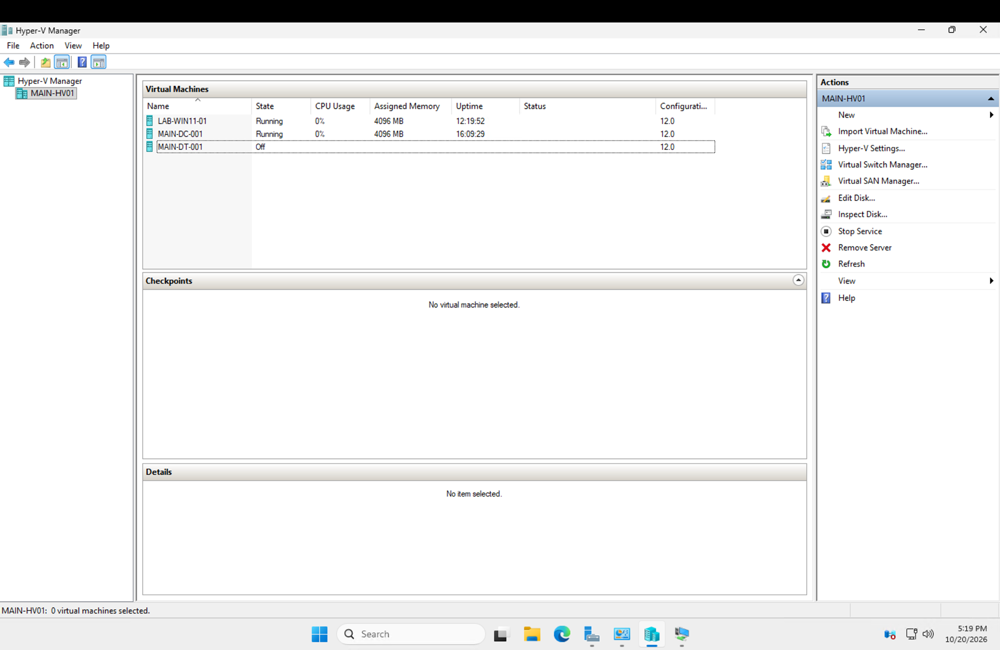
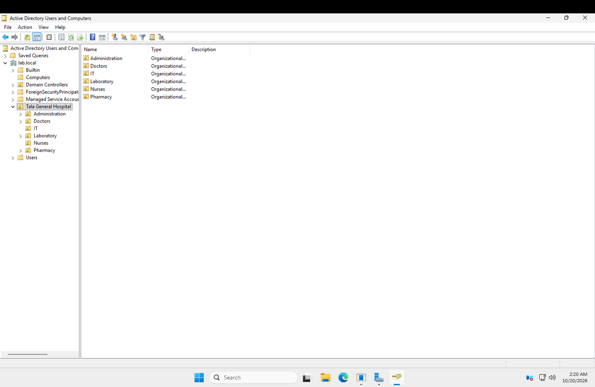
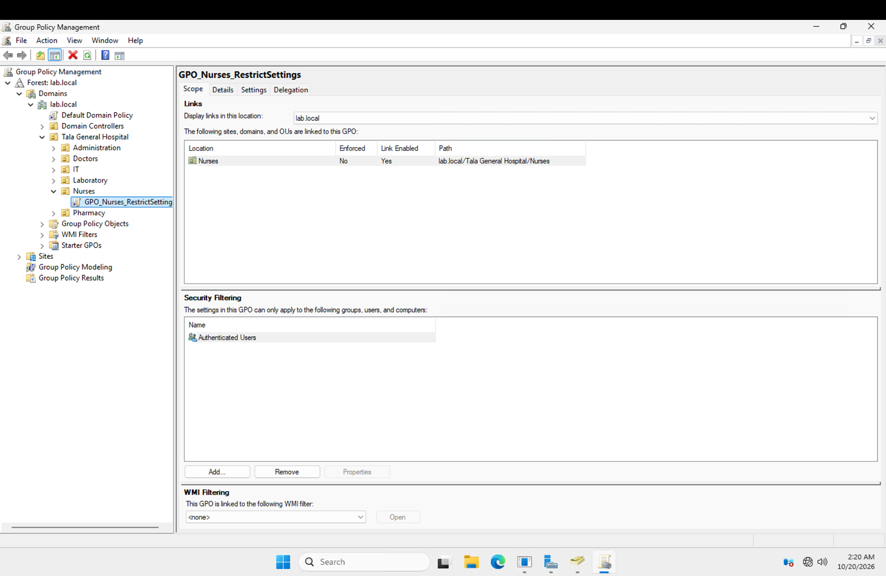

# Windows Server 2025 & Active Directory Homelab

Hands-on IT Support and Windows infrastructure administration in a simulated hospital environment.

## Overview

This project documents my hands-on practice in Windows Server administration, Active Directory management, network troubleshooting, and IT Support through **Tala General Hospital**, a fictional hospital environment.

The lab connects infrastructure administration with support scenarios: building a Hyper-V host, organizing directory objects, inspecting Group Policy scope, and investigating domain connectivity. Ticket reports document infrastructure configuration, simulated support incidents, troubleshooting procedures, and technical findings.

## Technologies & Technical Skills

| Technology | Practice documented in this lab |
| --- | --- |
| Windows Server 2025 | Hyper-V host installation, server configuration, Remote Desktop and firewall troubleshooting |
| Hyper-V | External virtual switch configuration, Generation 2 VM creation, virtual networking and VM inventory |
| Active Directory Domain Services | `lab.local` domain setup, client domain joining and departmental OU organization |
| DNS | Domain-controller discovery, resolver troubleshooting and DNS query verification |
| Group Policy | GPO linking, OU targeting and security-filter scope inspection |
| Windows 11 | Client-side network diagnosis, domain joining and domain login testing |
| IT Support documentation | Incident investigation, change records, verification results and follow-up recommendations |

## Lab Infrastructure

| System | Role | Configuration / screenshot state |
| --- | --- | --- |
| `MAIN-HV01` | Windows Server 2025 Hyper-V host | Hosts the lab VMs |
| `MAIN-DC-001` | AD DS / DNS server for `lab.local` | Running; 4096 MB assigned memory |
| `LAB-WIN11-01` | Windows 11 lab client | Running; 4096 MB assigned memory |
| `MAIN-DT-001` | Desktop test VM | Powered off at capture time |

### Hyper-V Inventory

Hyper-V Manager on `MAIN-HV01` shows three virtual machines, all with configuration version 12.0. The inventory below captures their state at the time of the screenshot.



## Active Directory & Group Policy

### Active Directory Organization

Active Directory Users and Computers shows the `lab.local` domain and a `Tala General Hospital` parent OU with six department OUs:

```text
lab.local
└── Tala General Hospital
    ├── Administration
    ├── Doctors
    ├── IT
    ├── Laboratory
    ├── Nurses
    └── Pharmacy
```

This departmental structure supports directory organization and policy scoping.



### Group Policy Scope

Group Policy Management shows `GPO_Nurses_RestrictSettings` linked to:

```text
lab.local/Tala General Hospital/Nurses
```

The Scope tab shows **Link Enabled: Yes**, **Enforced: No**, security filtering for **Authenticated Users**, and no WMI filter. This screenshot documents policy linking and scope; client-side policy results are addressed separately in the ticket records.



## Featured IT Support Tickets

### [INC0000 — Domain Join Failure Caused by DNS Selection](tickets/INC0000.md)

**Status: Resolved**

- **Problem:** A Windows client could not contact a domain controller when joining `lab.local`.
- **Investigation:** Confirmed that dc01 answered DNS correctly, then identified router-provided IPv6 DNS on the affected client.
- **Resolution:** Disabled IPv6 on the client adapter as a lab workaround and joined the domain.
- **Verification:** Successful domain login as `LAB\ana.cruz` and confirmation of the computer object in Active Directory.
- **Follow-up:** Correct the DNS infrastructure so domain clients consistently use domain-controller DNS.

### [CHG0015 — Hyper-V Host Build & Network Configuration](tickets/CHG0015.md)

**Status: Resolved**

- **Change:** Replaced the earlier Proxmox installation with Windows Server 2025 Standard and Hyper-V on `MAIN-HV01`.
- **Troubleshooting:** Corrected static addressing on the host's vEthernet adapter after creating the external switch, removed extra addresses and configured an inbound ICMP rule.
- **Deployment:** Created a Generation 2 dc01 VM and promoted it to the `lab.local` domain.
- **Verification:** Checked host addressing, ping and Remote Desktop connectivity from the Mac, and domain DNS responses.

These cases preserve their historical names and recorded test results. Current screenshot inventory and scenario naming differences are described in the supporting documentation.

## Full Ticket Log & Documentation

**30 total tickets: 30 Resolved, 0 In Progress.** All 27 original exercises are resolved based on the lab owner’s confirmation. INC0018 and INC0019 are also resolved based on owner confirmation. [CHG0018 — Department Wallpaper Deployment via Group Policy](tickets/CHG0018.md) documents six department-specific wallpapers deployed through SYSVOL-backed UNC paths and department GPOs, including correction of a path issue that caused a black desktop background. All six departments were verified through domain-user sign-ins, as reported by the lab owner. Detailed historical technical resolutions are retained for INC0000 and CHG0015; the other 25 original tickets identify owner-confirmed resolution with detailed work notes unavailable.

- [Full Ticket Log: all 30 resolved records](tickets/README.md) — identity support, permissions, Group Policy, DNS, printing and virtualization scenarios, with individual work and outcome records.
- [Lab environment](docs/lab-environment.md) — infrastructure configuration and screenshot details.
- [Fictional hospital standards](docs/references/COMPANY.md) — organizational context, naming conventions and scenario requirements.
- [Historical ticket requirements](docs/references/TICKETS.md) — original requests and acceptance criteria.
